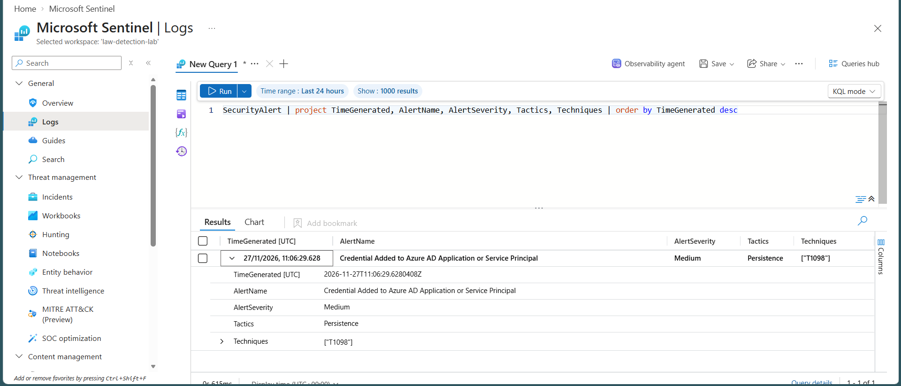
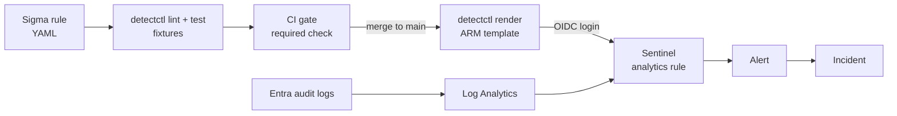
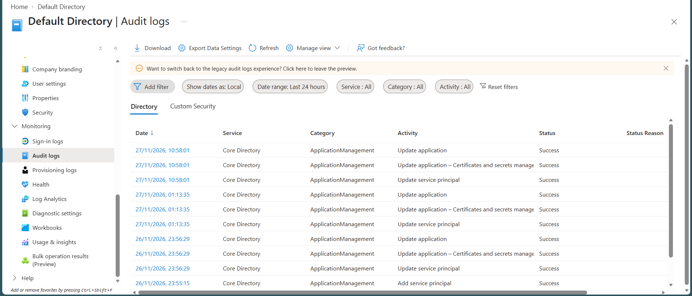
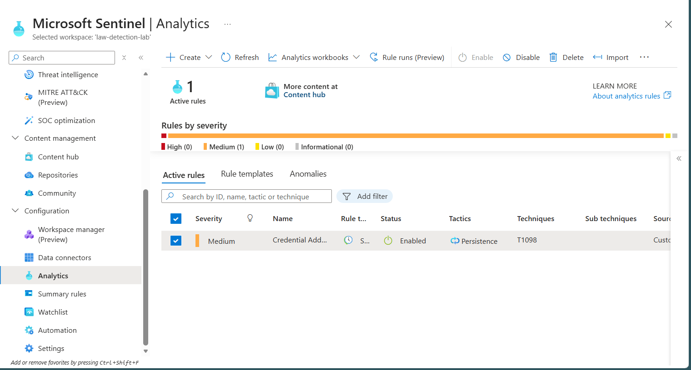
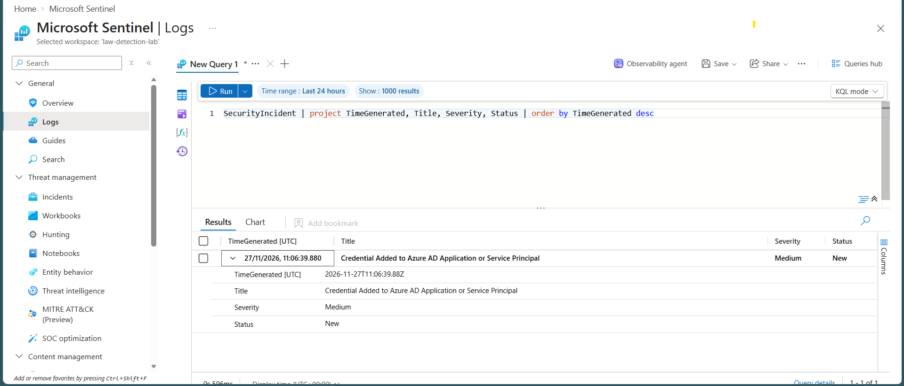
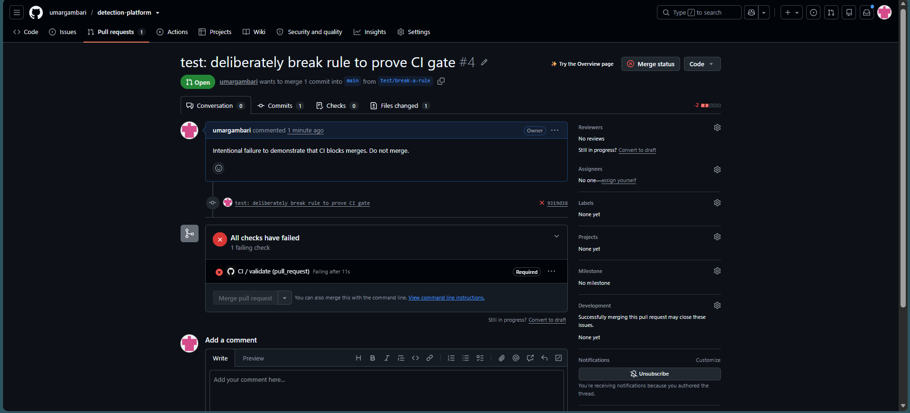
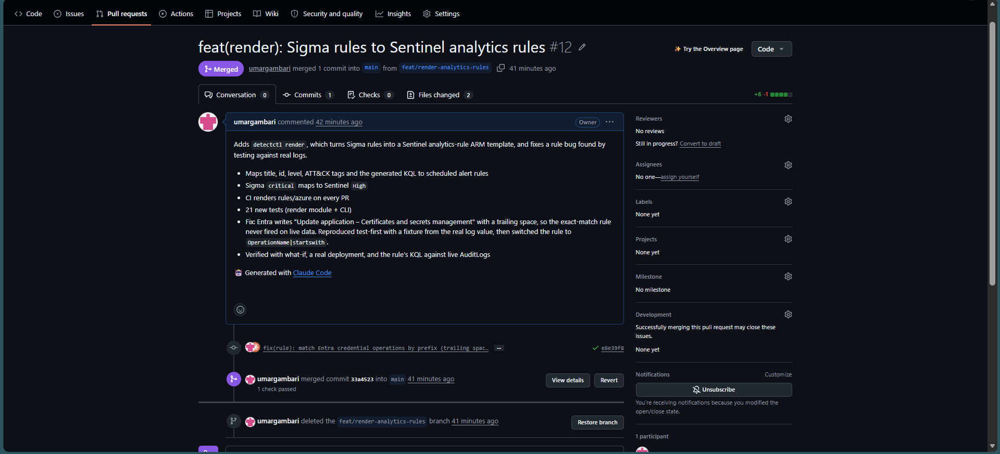
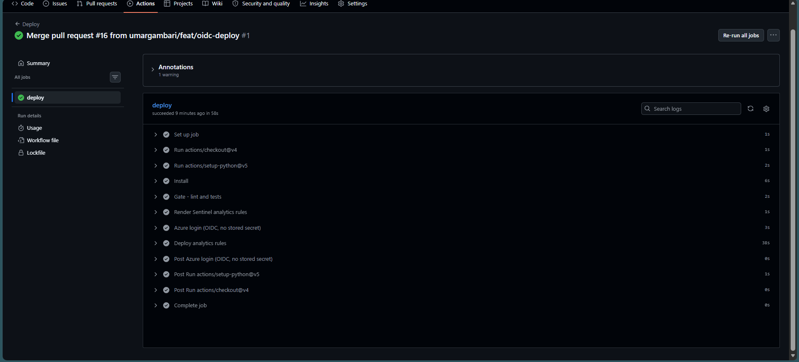
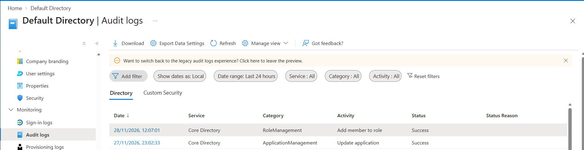
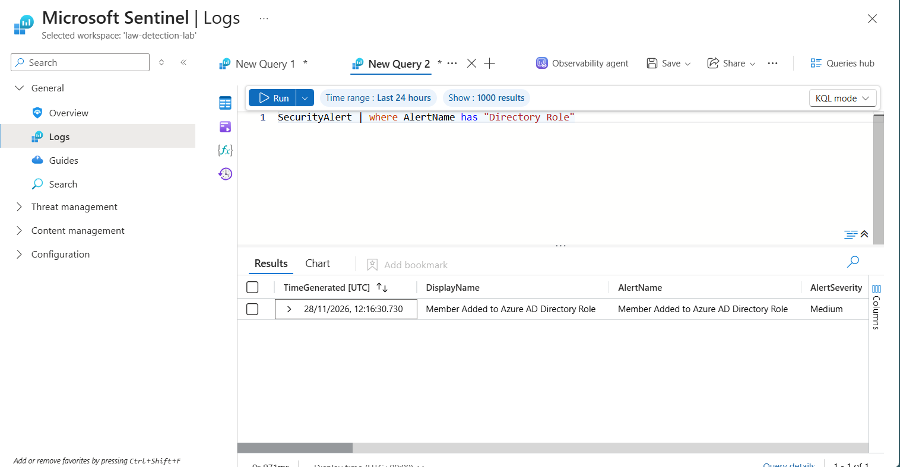

# detection-platform

Detection-as-code for Microsoft Sentinel. Detections are written as Sigma rules, tested against sample events, gated by CI, rendered into Sentinel analytics rules, and deployed by a pipeline that logs in to Azure with OIDC, so no secret is stored anywhere.



## What it does



- **Rules as code:** each detection is one Sigma file with ATT&CK tags, a severity and a sample-event fixture set.
- **`detectctl`:** a small Python CLI with four commands: `lint`, `test`, `convert` (Sigma to KQL) and `render` (Sigma to a Sentinel analytics-rule ARM template).
- **CI gate:** every PR must pass lint, fixture tests, unit tests, KQL conversion and template rendering. The check is required, so a broken rule cannot merge.
- **Keyless deploy:** on merge to `main`, GitHub Actions requests an OIDC token, logs in to Azure through a federated credential, and deploys the rendered rules. No client secret exists in the repo or in GitHub.
- **Infrastructure as code:** the Log Analytics workspace and Sentinel onboarding are defined in Bicep (`infra/main.bicep`), with a daily ingestion cap to protect the free credit.

## Results

Tested end to end on a real Azure lab tenant.

| Step | Time (UTC) | Evidence |
|---|---|---|
| Client secret added to an app registration (the attack) | 10:58:01 | [Entra audit log](docs/images/01-entra-audit-event.png) |
| Sentinel alert raised | 11:06:29 | [Alert](docs/images/03-sentinel-alert-fired.png) |
| Sentinel incident created | 11:06:39 | [Incident](docs/images/05-sentinel-incident-created.png) |

Event to alert took about 8.5 minutes. Most of that is Entra's export delay into Log Analytics plus the rule's 5-minute schedule, not the rule logic.

A second rule, a member added to an Entra directory role (T1098.003), went through the same pipeline and was triggered for real by assigning a low-risk role to a test user:

| Step | Time (UTC) | Evidence |
|---|---|---|
| Role assigned (the attack) | 12:07:01 | [Entra audit log](docs/images/08-entra-role-add-event.png) |
| Sentinel alert raised | 12:16:30 | [Alert](docs/images/07-sentinel-role-alert.png) |

Event to alert: 9 minutes 29 seconds.

| Control | Evidence |
|---|---|
| Rule deployed from code | [Rule enabled in Sentinel](docs/images/02-sentinel-rule-enabled.png) |
| CI blocks a deliberately broken rule | [PR #4, merge blocked](docs/images/ci-gate-blocked.png) |
| Rendering shipped through a PR | [PR #12, merged](docs/images/04-pr-render-merged.png) |
| Pipeline deploys with OIDC, no stored secret | [Deploy run](docs/images/06-deploy-oidc-green.png) |

## Evidence

**1. The attack shows up in Entra's audit log** (a client secret added to an app registration)



**2. The detection is deployed from code and enabled in Sentinel**



**3. The alert fires**


**4. Sentinel opens an incident for it**



**5. The CI gate blocks a deliberately broken rule**



**6. The renderer shipped through a pull request**



**7. The pipeline deploys with OIDC, no stored secret**



**8. A second rule: the role assignment shows up in Entra's audit log**



**9. ...and raises an alert in Sentinel**



## A bug that only real data found

The first version of the rule matched Entra's operation name exactly, and every test passed. Against live logs it never fired. Narrowing the query step by step and dumping the characters of the real value showed that Entra writes `Update application – Certificates and secrets management` with a **trailing space**. I reproduced it first as a failing fixture copied from the real log value, then switched the rule to `OperationName|startswith`. Lesson: fixtures drawn from real events catch what hand-written ones can't.

## Design decisions

- **Only `rules/azure` is deployed.** Sentinel validates the KQL against the workspace schema, and the Windows rules reference tables (such as `SecurityEvent`) that this lab doesn't ingest. They are still linted, tested and converted.
- **Alert suppression is on (1 hour).** It keeps the lab quiet, but it can hide a second attack inside the window. A production rule would be tuned per detection.
- **OIDC over a stored secret.** The federated credential only trusts this repository's `main` branch, and the deploy workflow doesn't run on pull requests.
- **Explicit incident setting.** `createIncident` is declared in the template instead of relying on Azure's default.
- **Cost guardrails:** a daily ingestion cap on the workspace and a teardown script (`scripts/teardown.sh`) that removes the resource group.

## Use it

```bash
pip install -e ".[dev]"
detectctl lint rules          # quality bar for every rule
detectctl test rules          # run rules against their sample events
detectctl convert rules --target azuremonitor --out build/kql
detectctl render rules/azure --out build/sentinel/analytics.json
pytest -q
```

## Layout

| Path | Purpose |
|---|---|
| `rules/` | Sigma rules (`azure/`, `windows/`) |
| `tests/` | Unit tests and per-rule sample events |
| `detectctl/` | The CLI: lint, test, convert, render |
| `infra/` | Bicep for the workspace and Sentinel |
| `scripts/` | Teardown script |
| `.github/workflows/` | `ci.yml` (gate) and `deploy.yml` (OIDC deploy) |

## Limitations and next steps

- Two rules are deployed to Sentinel; the three Windows rules need a Windows log source first.
- More Entra detections (new user created, conditional access changes).
- Logic Apps response playbooks.
- Drift detection between the repo and what is live in Sentinel.

## How this was built

I built this with Claude as a pairing partner for scaffolding, review and debugging. The design decisions, the Azure setup, every deployment and the real-data debugging were mine.
